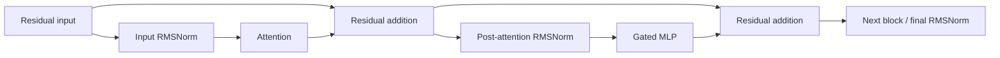

# GhostTrace: mechanistic interpretability workbench

Status: design roadmap, October 27, 2026. The v2 local implementation and measured diagnostic are now documented in [implementation status](MECH_INTERP_IMPLEMENTATION.md); that document distinguishes implemented capabilities, diagnostic artifacts and remaining scientific validation. This roadmap preserves the original design rationale. The existing recorded persona experiment and its immutable manifests remain unchanged.

## Product direction

Make GhostTrace a local-first space for asking: **which internal computations affect a specified model output, under a specified intervention?** Keep persona comparison as one study preset alongside copying, indirect-object identification, factual recall, instruction sensitivity and user-defined contrastive tasks. A task is useful only after its baseline behavior is measured; a model that cannot perform it does not supply a successful circuit-discovery example.

The main research loop should be:

1. Define prompts, a target metric and a hypothesis.
2. Inspect tokens, component activations and output readouts.
3. Specify a controlled intervention.
4. Measure changes and controls across examples.
5. Save a replayable case study, including null results and failed hypotheses.

## Current foundation and gaps

The current Qwen adapter captures real post-block residual vectors before the final norm, with verified continuation alignment. The UI exposes paired distances, saved token maps and provenance. The engine already supplies immutable runs, a queue, raw-array export, safe offline recomputation, human ratings and automated release gates.

The next release needs component-level capture, a raw activation inspector, output-target readouts, interventions and a computation graph. Existing condition validation is intentionally restricted to neutral/remorseful/unremorseful, and canonical capture requires sixteen continuation tokens. Preserve that v1 protocol rather than quietly relaxing its contracts.

Introduce a separate versioned research-study schema with named conditions, arbitrary role messages, baseline/variant pairs, explicit token correspondence, capture profiles, output targets and intervention specifications. Preserve v1 import/replay and test both protocol versions independently.

## Milestone 1: activation microscope and component graph

### Linked research workspace

Use synchronized panes: prompt/token strip; layer/component graph; selected activation details; target-output readout. Selecting a graph node or token updates every relevant pane. Keep exact tensor site, token IDs, absolute positions, model revision, normalization state, dtype, unit IDs and missing-data reasons inspectable.

Capture profiles should opt into:

- `resid_pre`, `attn_out`, `resid_mid`, `mlp_out`, `resid_post` and a separately named final normalized residual.
- Selected attention-head outputs before output projection, with explicit head/channel axes.
- Selected MLP gated intermediate channels, separately identified from residual dimensions.
- Attention patterns for bounded layer/head/query-token selections, as an advanced capture mode.

For the current sequential Qwen block, the component DAG should expose the actual residual additions:

The graph comes from the validated adapter/module configuration. Nodes initially represent architectural components, not discovered concepts. Raw residual coordinates and MLP channels must retain their literal identities; a high activation alone does not justify a semantic neuron label.

The Qwen2.5-0.5B configuration has 24 blocks, 14 query heads and 2 key/value heads. Preserve this grouped-query relationship instead of rendering fourteen independent KV heads. Read all dimensions from the pinned config. [Official model configuration](https://huggingface.co/Qwen/Qwen2.5-0.5B-Instruct/raw/main/config.json).

### Inspector and readouts

Provide raw values for selected dimensions, distributions, norms, signed differences, token-by-channel maps, and comparisons on a shared scale. Top-k views must disclose omitted channels; omitted values are not zero.

Add an exploratory logit lens: selected target-token rank/logit/probability and top-k tokens by layer, using an explicitly recorded normalization/unembedding convention. Do not describe intermediate readouts as a transcript of the model's thoughts. A tuned lens is a separate trained artifact, with development-only fitting and held-out evaluation. [TransformerLens analysis tools](https://transformerlensorg.github.io/TransformerLens/content/analysis_tools.html), [tuned-lens paper](https://arxiv.org/abs/2303.08112).

### Exit criteria

- On real pinned weights, component capture leaves output logits unchanged within the established tolerance.
- Residual bookkeeping verifies the two addition identities, with bias terms represented where applicable.
- Final-normalized values remain distinct from raw block outputs.
- Head contribution reconstruction respects the actual output projection and GQA layout.
- Hook removal, failure cleanup and model release are tested.
- Graph navigation and every chart have keyboard and table equivalents.

## Milestone 2: controlled interventions

Add an intervention builder that records donor, recipient, component site, block/head/channel, semantic token mask, absolute positions, replacement rule and target metric. Keep the baseline study immutable; every intervention is a new content-addressed job referencing its source runs.

Start with exact residual/component activation patching and mean/zero ablation. Use single-layer or selected-head experiments before expensive sweeps. The primary readout should be a preregistered next-token logit difference or fixed-candidate continuation likelihood contrast. Display raw deltas. Normalized recovery is secondary and unavailable when the baseline gap is too small; do not clamp genuine effects to a persuasive 0–100% range.

Mandatory controls include untouched baseline, self-patch, same-condition donor, reverse-direction patch, and a declared norm-matched random donor where scientifically appropriate. Compare ablation choices: zeroing can create an out-of-distribution state. Verify matched semantic/absolute positions and exclude incompatible pairs instead of patching a shared token index across unrelated text.

Node patching can establish an effect on a chosen output metric under that intervention. An edge-level mechanistic claim needs an appropriate path/edge intervention, not just two important nodes. Attribution patching can rank candidates cheaply as a first-order approximation; validate selected candidates with exact interventions. [TransformerLens patching reference](https://transformerlensorg.github.io/TransformerLens/generated/code/transformer_lens.patching.html).

### Graph evidence types

| Graph element | Meaning | Required evidence |
| --- | --- | --- |
| Structural edge | Connection in the model's computation | Validated architecture/module map |
| Activation overlay | Observed value or paired difference | Referenced capture, mask and statistic |
| Attribution estimate | Approximate importance for a target | Method, gradient/baseline settings and approximation label |
| Intervention result | Measured change under a specified patch/ablation | Baseline, intervention, controls and metric |
| Tested path edge | Measured effect of a particular computational route | Path-intervention protocol and controls |

Keep unmeasured edges distinct from measured zero effects. Graph filtering must retain counts and thresholds for hidden nodes/edges. A sparse displayed subgraph is a research hypothesis until relevant interventions and held-out checks support it.

### Exit criteria

- Analytic toy-model tests recover known effects; self-patches preserve baseline.
- Real-model tests verify the requested intervention is applied only at the selected site/mask and is removed after completion or error.
- Zero baseline gaps, invalid alignment and unsupported operations have explicit states.
- Results preserve per-example values, controls, exclusions, family/group structure and intervention settings.
- A measured copying/recall case study and the persona study remain separate; no prompts are selected to manufacture impressive recovery.

## Milestone 3: feature and circuit research

Support imported sparse autoencoder or transcoder dictionaries only with an exact compatibility record: base model and revision, capture site, layer, width, dtype/preprocessing, dictionary revision, license and reconstruction/behavioral fidelity evidence. Keep reconstruction error and residual/unexplained contributions visible. Feature names are annotations backed by activation examples and tests, not ground truth.

SAELens can encode/decode activations from PyTorch/Hugging Face without requiring a wholesale replacement of the current adapter. [SAELens repository](https://github.com/decoderesearch/SAELens).

Evaluate a separate model profile for published feature circuits. The currently documented circuit-tracer inventory includes Qwen3 0.6B transcoders; that does not establish compatibility with the existing Qwen2.5-0.5B experiment. Pin and validate both model and dictionary before adding such a profile. Existing Qwen2.5 results remain their own baseline. [Circuit-tracer compatibility and transcoders](https://github.com/decoderesearch/circuit-tracer#available-transcoders).

Feature attribution graphs need reconstruction and graph-coverage information, plus intervention checks in the original model. Published circuit-tracing methods explicitly discuss incomplete replacement models and limitations of mechanistic faithfulness. [Circuit tracing methods](https://transformer-circuits.pub/2025/attribution-graphs/methods.html).

Avoid training a feature dictionary from the thirty persona scenarios as a shortcut. Plan an appropriately diverse development corpus and held-out validation, or use a genuinely compatible published artifact.

## Research records and automated evaluation

Add versioned `CaptureSite`, `TargetMetric`, `Intervention`, `GraphNode`, `GraphEdge` and `Hypothesis` entities. Every graph measurement links back to its immutable units and artifacts. Record signed raw effects, uncertainty, mask, baseline and controls; distinguish observations, estimates, intervention results and human interpretations.

Case studies should contain a question, prior hypothesis, protocol, expected effect, actual result, alternative explanations, control outcomes and supported/refuted/unresolved status. Export a compact read-only case and a reproducible local protocol.

Extend existing validation with module/site shape checks, residual identities, logit parity, head/GQA bookkeeping, known-effect toy interventions, exact self-patches, no-op restoration, gradient estimates versus exact patches, resource quotas, teardown and legacy replay. Agent review should challenge hypotheses and missing controls. It must not silently generate human ratings or certify psychological explanations.

## Storage and execution budgets

Keep the existing direct Hugging Face adapter for the first two milestones. Additional frameworks need a separate pinned compatibility profile and logit/activation parity checks; transformations of weights or residual bases cannot be treated as transparent.

Default to selected layers, sites and token windows. For the fallback model, storing all full attention matrices at 512 tokens in FP32 is approximately `24 × 14 × 512 × 512 × 4 = 352 MB` per forward, before other artifacts. This is an arithmetic storage estimate, not a memory benchmark. Additional component/head/channel captures can exceed the existing quota across a pilot.

Preflight each capture profile, estimate bytes before queueing, and retain explicit selected-index maps. Stream or chunk larger local data; export bounded browser tiles/summaries with hashes and shape metadata. Missing/truncated/filtered values remain distinguishable from numerical zero. Exact patch sweeps and gradient-based methods require explicit compute budgets.

## GitHub Pages demo after the measured milestones

GitHub Pages serves static HTML/CSS/JavaScript, so it can host the research viewer and recorded results. The Python API, model inference and new interventions remain local. [GitHub Pages documentation](https://docs.github.com/en/pages/getting-started-with-github-pages/what-is-github-pages).

Build a dedicated static-demo mode from the same UI:

- Automatically open a curated measured case, with a persistent recorded/read-only banner.
- Support component graph navigation, token selection, saved activation tiles, logit readouts and recorded intervention comparisons.
- Provide a guided inspection of baseline, patch, controls and limitations, with downloadable evidence.
- Keep local ZIP import in the browser; do not upload a visitor's research data.
- Replace compute/rating-save/API controls with a clear local-install path. Make no `/api` requests in the static demo.
- Keep model weights, credentials, local paths and the metadata database out of `dist/`.

The current recorded-smoke fetch already uses `import.meta.env.BASE_URL`. Add the appropriate project-site Vite base, for example `/Ghost-Trace/` only if that is the actual repository name. Use GitHub Actions to build and upload `dist/`, with deployment after the new scientific and browser gates pass. Follow the actual repository slug rather than assuming the workspace directory name. [Vite GitHub Pages deployment](https://vite.dev/guide/static-deploy.html#github-pages).

Pages acceptance should include a production build served under a repository subpath, direct entry/reload, working fonts/assets/bundle downloads, zero live API calls, no external model downloads, narrow-screen/keyboard tests, and replay with external network access blocked. Publish only the measured feature set and its case-study evidence; precomputed intervention playback must never appear to be a newly executed forward pass.

## Recommended order

1. Versioned general studies, component capture, activation microscope and structural graph.
2. Controlled patching/ablation and target-output readouts; validate one small real case end to end.
3. A polished GitHub Pages demo of those measured capabilities.
4. Compatible feature dictionaries, circuit attribution/path patching and a broader case-study library.

This order makes the first public demo useful for research before the more expensive feature-circuit work is complete, while preserving a clear path to it.
