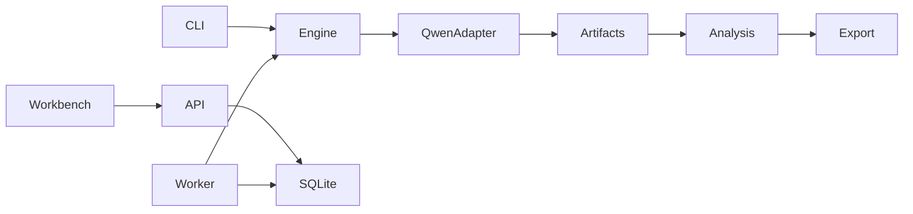

# Local architecture

The React/TypeScript/Vite workbench talks to one localhost FastAPI process. CLI and API share Python engine services. A separately launched single worker owns the loaded Transformers model and claims SQLite jobs transactionally. API restarts must not restart inference. SQLite contains metadata; NPZ files contain selected activation slices.

Freeze manifest content separately from mutable job status. Unit hashes include experiment, scenario, condition, template, mode, continuation and seed. Commit a unit after atomic artifact write/checksum. Verified completed units are reused on a new resume attempt, never silently overwritten. Heartbeat and cancellation occur independently of long model units; cancellation applies between bounded units.

Local binding, Host/Origin validation, per-session mutation credentials and allowlisted local models reduce browser-to-localhost abuse. Imports must not execute code, follow arbitrary paths or download weights. Explicit download is separate; subsequent model execution uses local files. Static public deployments can provide only read-only verified replay, never this Python worker or local private data.

A valid export carries manifest, environment, dataset/template hashes, raw unit inventory, outputs, metrics, exclusions and optional selected arrays with checksum inventory. Load NPZ with allow_pickle=False and bound file sizes/shapes. Unavailable metrics use null/reason; JSON must not contain NaN or infinity.
